# SupplyTrack screenshots

Captured on an Android 14 emulator (Pixel 6, API 34) by the UI walkthrough test,
commit 6786401 on `main`.

### 01_dashboard

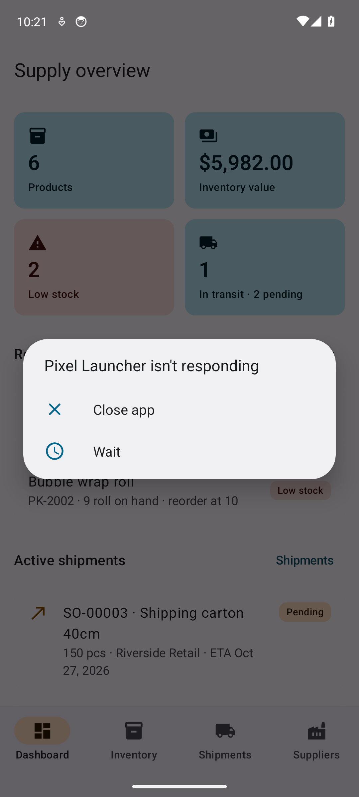

### 02_inventory

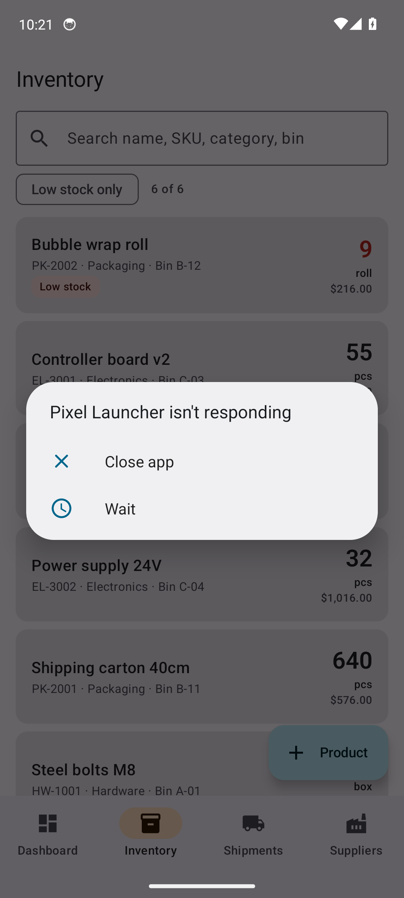

### 03_inventory_search

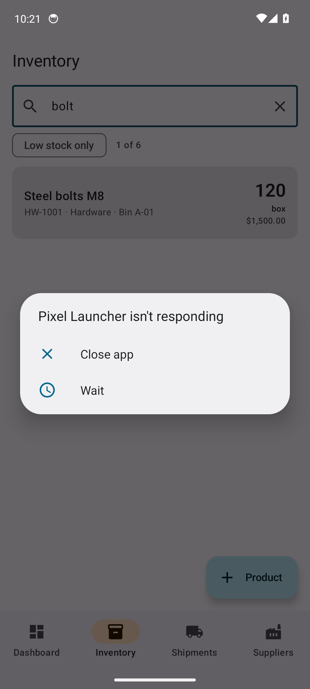

### 04_product_detail

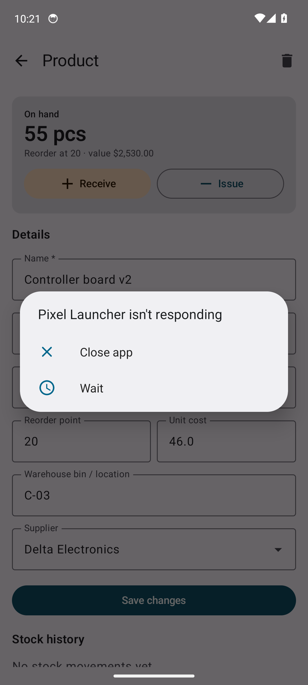

### 05_product_after_receiving

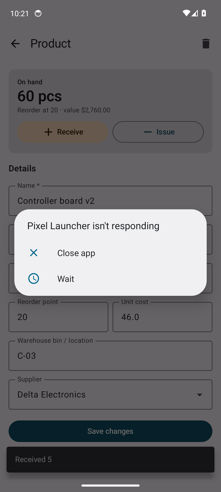

### 06_shipments

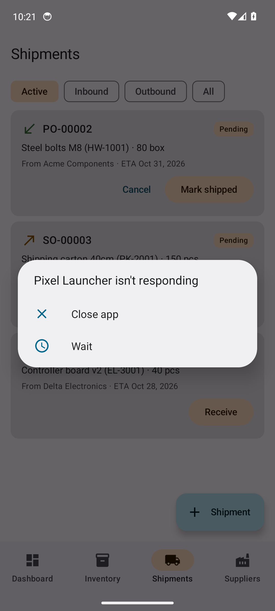

### 07_shipment_dispatched

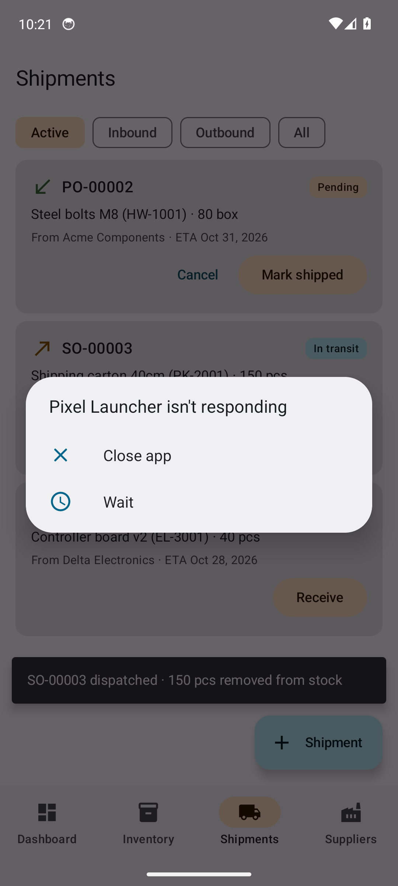

### 08_new_shipment_form

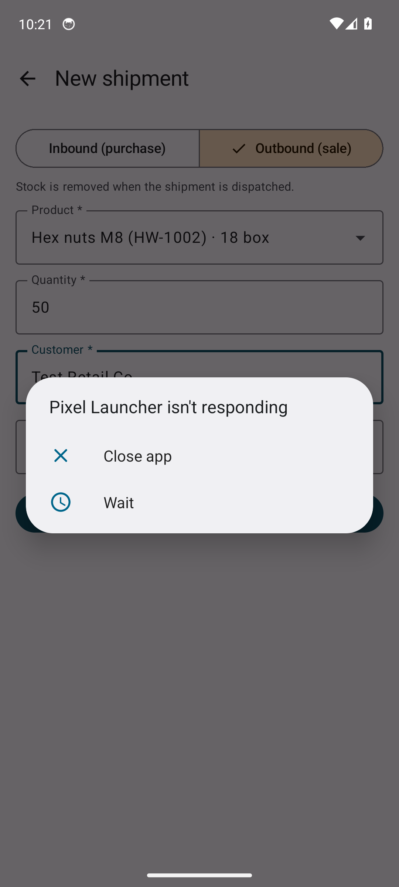

### 09_dispatch_blocked_low_stock

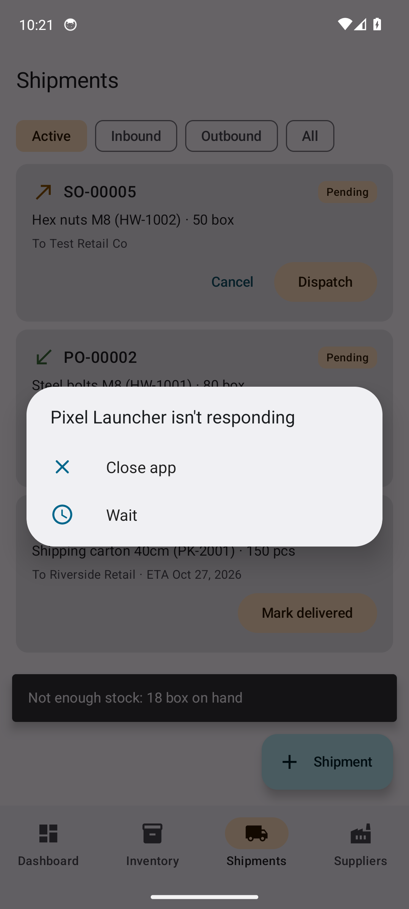

### 10_suppliers

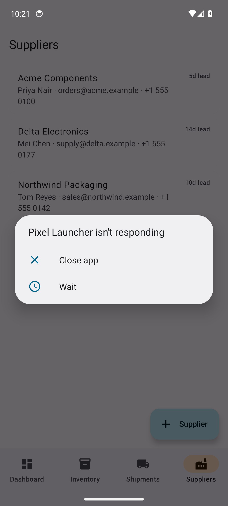

### 11_dashboard_after_changes

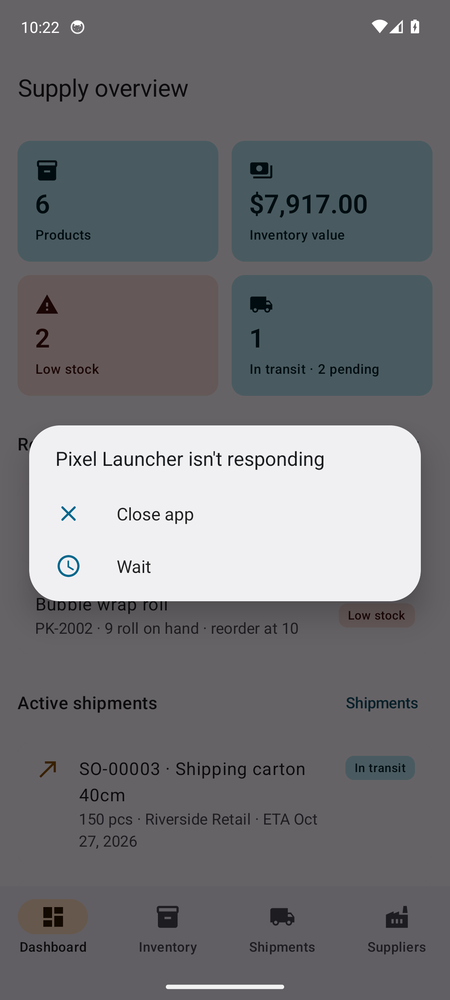

